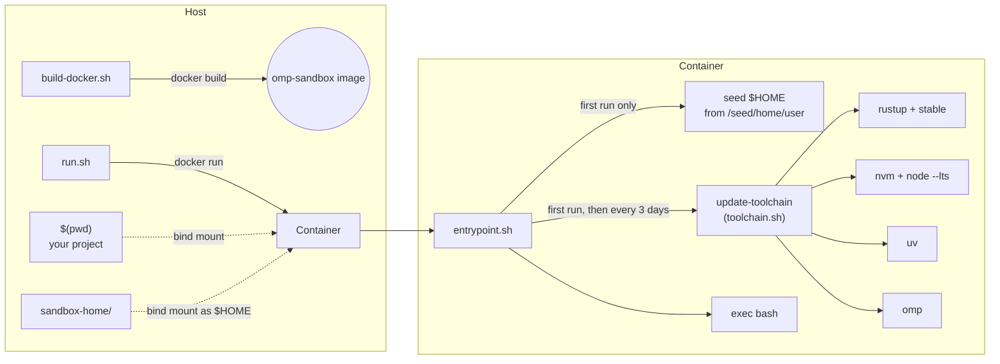

# Docker sandbox for omp (oh-my-pi)

[](LICENSE)

A disposable, Docker-based development sandbox for running [omp (oh-my-pi)](https://omp.sh) — or any other terminal tooling — against a real project without touching your host machine's toolchains, dotfiles, or permissions.

It gives you a non-root Linux container that:

- mounts your current project directory as the workspace,
- persists a **separate** home directory across runs (shell history, rust/node/uv installs, omp config),
- keeps Rust, Node (via nvm), `uv`, and `omp` itself up to date automatically, and
- runs as your host UID/GID so files created in the container are owned by you, not `root`.

## Rationale

Agentic coding tools and ad-hoc toolchain installs are easy to run, harder to run *safely*. `omp-sandbox` trades a little setup for isolation: a bad `rm -rf`, a rogue install script, or an agent run gone sideways is contained to a throwaway container and a `sandbox-home/` directory you can delete at any time.

## Architecture



## Prerequisites

- Docker (or a compatible CLI: Podman with the `docker` alias works too)
- Linux or WSL2 host (UID/GID mapping and bind mounts assume POSIX permissions)

## Quick start

```bash
# 1. Build the image once (re-run after editing the Dockerfile)
./build-docker.sh

# 2. From inside any project you want to work on, launch the sandbox
cd /path/to/your/project
/path/to/omp-sandbox/run.sh
```

You land in a `bash` shell at `~/<project-name>`, with your project's files mounted read-write and a persistent, isolated `$HOME`. On the very first run — and again automatically every 3 days — the container installs/updates Rust, Node LTS, `uv`, and `omp`.

## What each script does

| Script | Runs where | Purpose |
| --- | --- | --- |
| `Dockerfile` | build time | Base image (`buildpack-deps:trixie`) + `sudo`, `ripgrep`, `vim`, `clang`, `libgtk-4-dev`; creates a non-root user matching your host UID/GID; snapshots the fresh home directory to `/seed/home/<user>` for later seeding. |
| `build-docker.sh` | host | Builds the `omp-sandbox` image, passing your current `id -u`/`id -g`/username/groupname as build args so in-container file ownership matches your host user. |
| `run.sh` | host | Runs the container: mounts `./sandbox-home` as `$HOME` and the current working directory as the workspace, `-h sandbox` for a recognizable prompt, `--rm -it` for a disposable interactive session. Cleans up the empty workspace mountpoint directory left behind in `sandbox-home/` after exit. |
| `entrypoint.sh` | container, every start | Seeds `$HOME` from the image's `/seed` snapshot on first use, conditionally invokes `update-toolchain`, then `exec`s the container's `CMD` (default: `bash`). |
| `toolchain.sh` (installed as `/usr/local/bin/update-toolchain`) | container | Idempotently installs or updates `rustup` + the `stable` toolchain, `nvm` + Node LTS, `uv`, and `omp`; touches `~/.toolchain_last_updated` as a cache marker. |

## Persistent state: `sandbox-home/`

`run.sh` bind-mounts `./sandbox-home` (created on demand, git-ignored) as the container's `$HOME`. This is what makes the sandbox useful across sessions instead of fully ephemeral:

- Installed toolchains (`~/.cargo`, `~/.rustup`, `~/.nvm`, `~/.local/bin`) survive container restarts, so you don't reinstall Rust/Node/uv/omp every run.
- Shell history, `~/.bashrc` customizations, and `omp` configuration persist too.
- Deleting `sandbox-home/` resets the sandbox to a clean slate — the next `run.sh` reseeds it from the image.

Your actual project is **not** stored here; it's bind-mounted directly from `$(pwd)` on the host, so edits are immediately visible outside the container and nothing you do in the sandbox is lost if you delete `sandbox-home/`.

## Toolchain maintenance

`entrypoint.sh` runs `update-toolchain` when `~/.toolchain_last_updated` is missing (first run) or older than 3 days. `toolchain.sh` then, for each tool, updates it if already installed or installs it fresh:

- **Rust** — `rustup update` / `rustup toolchain install stable` via the official `rustup.rs` installer.
- **Node.js** — `nvm` tracks its latest release tag; `nvm install --lts` keeps Node on the current LTS line.
- **uv** — Astral's Python package/venv manager, installed via `astral.sh/uv/install.sh`.
- **omp** — installed/updated via `curl -fsSL https://omp.sh/install | sh`.

Set `NO_COLOR=1` to disable the colored status output from `entrypoint.sh` / `toolchain.sh`.

## Customization

- **Installed apt packages / base image**: edit the `RUN apt-get install` list or `FROM` line in `Dockerfile`, then rebuild with `./build-docker.sh` (use `NOCACHE=--no-cache ./build-docker.sh` to force a clean rebuild).
- **Container username**: defaults to your host username/groupname via build args in `build-docker.sh`; override by editing those `--build-arg` values directly.
- **Timezone**: set via `ENV TZ=...` in `Dockerfile`.
- **Default shell command**: change `CMD ["/bin/bash"]` in `Dockerfile`, or pass an override to `docker run` by extending `run.sh`.
- **Toolchain update interval**: adjust the `-mtime +3` check in `entrypoint.sh`.

## Security notes

- The container user has passwordless `sudo` (`NOPASSWD:ALL`) *inside the container only* — convenient for ad-hoc `apt-get install`, but treat the container as trusted-but-disposable, not hardened.
- `run.sh` passes `--user $(id -u):$(id -g)`, so files written to the bind-mounted workspace or `sandbox-home/` are owned by your host user, not root — important since both are plain bind mounts, not Docker volumes.
- Isolation is at the container boundary: it protects your host filesystem and toolchains from an unpredictable process (e.g. an AI coding agent or an unfamiliar install script) running inside, not the other way around.

## Project layout

```
.
├── Dockerfile          # image definition: base packages, non-root user, home seed
├── build-docker.sh     # builds the image with host-matching UID/GID build args
├── run.sh              # launches a disposable container for the current project
├── entrypoint.sh       # container init: seed $HOME, run toolchain maintenance, exec shell
├── toolchain.sh        # installs/updates rust, node (nvm), uv, and omp
├── LICENSE             # Apache License 2.0
├── .gitignore          # excludes sandbox-home/ (generated, host-specific)
└── sandbox-home/       # generated on first run; persistent container $HOME (git-ignored)
```

## License

Licensed under the [Apache License, Version 2.0](LICENSE).
